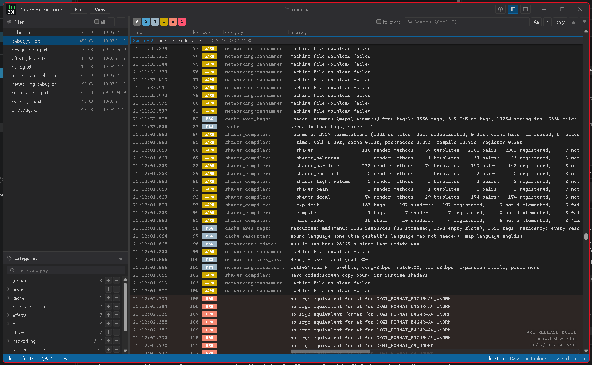

# Datamine Explorer



A desktop viewer for event logs and datamine files from Bungie's games, and from any project that writes them with [@blamnetwork/datamine](https://www.npmjs.com/package/@blamnetwork/datamine).

## What is datamine?

Bungie's engines log almost everything they do as **events**. An event is one line with:
- a time;
- a level: `verbose`, `status`, `message`, `warning`, `error` or `critical`;
- one or more categories, such as `networking:session:` or `hs:`;
- a message.

The game writes them to text reports: `debug.txt`, `debug_full.txt`, `networking_debug.txt` and the rest. Halo modders will know these from the `reports/` folder of the Halo Editing Kits, and Destiny writes the same kind of files.

**Datamine** is the same stream of events, packed into compact binary `.datamine` files and uploaded to a datamine server so the developers could see what was happening on players' machines.

Datamine Explorer opens both kinds, and anything else written in those formats.

## Features

- **Opens everything:**
  - Halo-style and Destiny-style text reports;
  - binary `.datamine` files in every layout (Halo 3, Halo: Reach, Destiny);
  - zipped datamine uploads;
  - text exports of datamine.
- **A folder at a glance.** Open a report folder and pick any file from the tree.
- **Huge files.** Multi-gigabyte logs open without a size limit. The file is indexed as it streams in, and only the rows on screen are read.
- **Filter and search:**
  - Toggle levels on and off.
  - Include or exclude categories from the category tree.
  - Search with case-sensitive and regex options. Matches are highlighted, with next/previous and a "matches only" view.
- **Sessions.** Logs that several runs appended to are split into sessions. A divider marks each one and stays pinned while you scroll through it.
- **Live.** Files are watched while open, so new lines appear as the game writes them. Follow tail keeps the newest line in view.
- **Connect to a running server.** Projects using `@blamnetwork/datamine` can host a live event stream. File > Connect shows their events as they happen, and Save as keeps a copy.
- **Details.** Select an event to see its full text, raw line, context and datamine parameters. The Session panel shows the build, session id, time range and counts per level and category.
- **Copy.** Select rows with click, Shift and Ctrl, then press Ctrl+C to copy their raw lines.
- **Comfortable.** Dark and light themes, resizable columns, wrapped or single-line messages, and a recent files list.

## Download

Builds for Windows, macOS and Linux are attached to the [releases](https://github.com/craftycodie/Datamine-Explorer/releases):
- **Windows:** the setup `.exe`, or the portable `.exe`.
- **macOS** (Apple Silicon): the `.dmg`, or the `.app` as a `.app.tar.gz`.
- **Linux:** `.deb`, `.rpm` or `.AppImage`.

The macOS and Windows builds are not signed. On macOS, Gatekeeper will say the app cannot be opened: Control-click the app, choose Open, then Open again. If it says the app is damaged, run `xattr -cr "/Applications/Datamine Explorer.app"` once.

## Try it in the browser

[craftycodie.github.io/Datamine-Explorer](https://craftycodie.github.io/Datamine-Explorer/) runs the latest release in your browser, with nothing to install. Use Chrome or Edge for folder access: they can watch a folder and show new lines as they are written. Other browsers open a folder or file as a snapshot that does not update. Connecting to a server works in any browser.

## Keyboard

| Keys | Action |
| --- | --- |
| Ctrl+O / Ctrl+Shift+O | Open file / open folder |
| Ctrl+K | Connect to a server |
| Ctrl+W | Close |
| Ctrl+F, F3 / Shift+F3 | Search, next / previous match |
| Ctrl+C, Ctrl+A | Copy selected events, select all |
| End | Jump to the newest event |
| Ctrl+B / Ctrl+Alt+B | Show or hide the left / right pane |

## Building

Requires Node 22 and Rust.

```
npm install
npm run tauri dev      # run the app
npm run tauri build    # build the installer
```

Built with [Tauri](https://tauri.app) and React. Log parsing comes from [@blamnetwork/datamine](https://github.com/Blam-Network/tiger/tree/main/packages/datamine).
